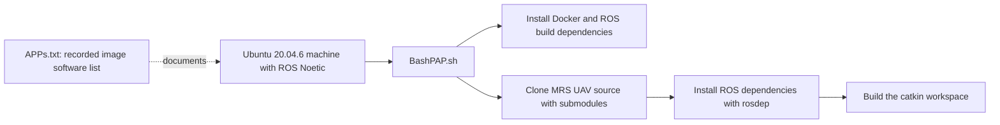
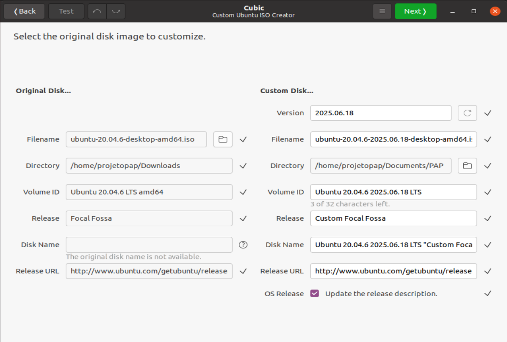
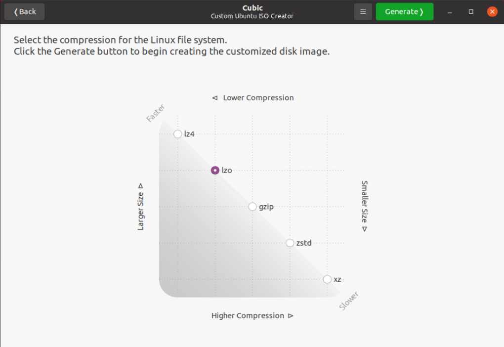
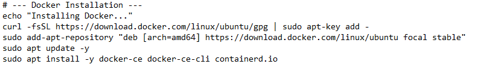
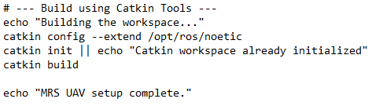

# Robuntu

**A robotics-focused Ubuntu setup designed to make preparing multiple computers more repeatable.**

Robuntu is an educational project by two partners exploring how to bring a useful robotics toolchain to Ubuntu machines. The repository records the planned software set and a post-install script for Docker and the MRS UAV development workspace.

> **Project type:** educational prototype  
> **Base image:** Ubuntu 20.04.6 Desktop amd64, shown in the Cubic build capture  
> **Robotics stack:** ROS Noetic; the setup script expects `/opt/ros/noetic`  
> **Downloads:** this repository documents the project; it does not distribute the built ISO or VirtualBox disk image

## What you can learn

- How a Linux setup script adds software repositories and installs system packages
- How ROS environments, `rosdep`, and catkin work together
- How a setup script can clone a robotics project and build its workspace
- How to document a repeatable robotics workstation setup and its limits

## What the project contains

| File | Purpose |
| --- | --- |
| [`APPs.txt`](APPs.txt) | Software inventory recorded for the image |
| [`BashPAP.sh`](BashPAP.sh) | Post-install setup for Docker and the MRS UAV workspace |
| [`docs/SETUP_WALKTHROUGH.md`](docs/SETUP_WALKTHROUGH.md) | Guided explanation of the current setup script |
| [`docs/SHOWCASE_GUIDE.md`](docs/SHOWCASE_GUIDE.md) | Screenshot and project-presentation notes |

The current software inventory names ROS Noetic, Arduino and the Arduino IDE, OpenSSH, catkin tools, `rospy`, Singularity, and NoMachine. The setup script separately installs Docker and dependencies for MRS UAV. Treat the inventory as the project's recorded plan until it has been checked against a clean installation.

## How the setup flow fits together

The screenshots document a manual Cubic-based image customization process. The Cubic project files and complete build recipe are not in this repository, so the ISO cannot yet be reproduced from the tracked project files alone.

## Explore the setup script

Start with the [guided walkthrough](docs/SETUP_WALKTHROUGH.md). In brief, `BashPAP.sh`:

1. Checks that ROS Noetic is available at `/opt/ros/noetic`.
2. Adds the Docker repository for Ubuntu Focal and installs Docker packages.
3. Installs development and ROS dependency tools.
4. Creates a catkin workspace and clones the MRS UAV project if it is not already present.
5. Uses `rosdep` to install dependencies and `catkin build` to build the workspace.

The script changes apt sources, installs software with `sudo`, downloads code, and writes to the user's home directory. Review it before running, and first try it in a disposable virtual machine.

## Build process screenshots

These captures show selected steps from the image customization and setup work. They document the process; they are not a clean-machine test report or a live robotics demo.

### Choosing the Ubuntu base image

The Cubic project used an Ubuntu 20.04.6 Desktop amd64 image as its base and set a custom image identity.

### Preparing the customized filesystem

The Cubic screen shows the filesystem compression choice before generating the customized image.

### Post-install automation

The script's Docker setup section adds the Ubuntu Focal repository and installs Docker packages.

The final section configures and builds the MRS UAV catkin workspace.

A future showcase improvement is a real capture of the installed desktop with a ROS tool or MRS UAV simulation running.

## Current limitations

- The base ISO is Ubuntu 20.04.6 Desktop amd64, but the exact installation procedure and Cubic project configuration are not included.
- The package list does not pin software versions or show a verification result.
- The setup script targets ROS Noetic and uses Ubuntu Focal's Docker repository; it has not been documented as working on newer Ubuntu releases.
- The script uses `apt-key`; check the current Docker repository instructions before relying on that step on a newer system.
- The repository does not include an automated image build or a clean-machine test log.
- NoMachine appears in the image inventory. Its current license prohibits redistribution without written permission, so this project does not publish a prebuilt ISO. Check the terms for the exact included version before creating any public image download.

Ubuntu 20.04 reached the end of standard support in May 2025, and ROS Noetic reached end of life on May 31, 2025. Treat this as a legacy educational image, not a current general-purpose robotics workstation. See the [Ubuntu 20.04 lifecycle](https://ubuntu.com/20-04) and the [ROS package index](https://index.ros.org/r/ros/).

## License

The repository includes an MIT license for the project files it covers. Third-party software keeps its own license and redistribution terms.

## Contributors

Robuntu was developed by two project partners. Add both contributors' preferred names or GitHub handles here.